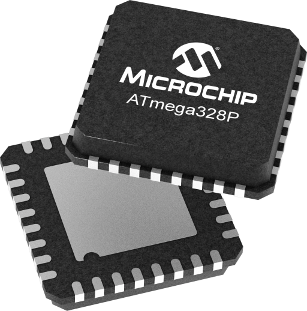

# Embedded-M01 ⚡

<p align="center">
  
</p>

This module continues the AVR learning path with a focus on timing, GPIO control, and stable low-level routines. It introduces the idea that software timing and output control are built from hardware registers, loops, and careful calibration.

The goal is to understand how embedded code produces reliable delays, toggles, and real-time behavior on the ATmega328P without relying on high-level abstractions.

## What you learn 🧠

This repository introduces the basics of timing and digital control on AVR microcontrollers:

- GPIO configuration and register-level toggling
- Delay generation using calibrated software loops
- LED blinking and state changes on output pins
- Basic timing calculations for a target clock frequency
- Firmware structure for small standalone AVR projects
- Compiling and flashing programs with `make` and `avrdude`

## Project setup 🛠️

This repository contains several small exercises under separate folders such as `ex00`, `ex01`, `ex02`, and `ex03`.

Each exercise is focused on a practical timing or GPIO challenge and is designed to be compiled independently.

## Build commands 🔧

From the project root, you can compile an exercise with:

```bash
make -C ex00 hex
```

To flash the firmware to the board:

```bash
make -C ex00 flash
```

To build and flash in one step:

```bash
make -C ex00 all
```

To clean generated build files:

```bash
make -C ex00 clean
```

If you are inside the exercise folder itself, the commands are simply:

```bash
make hex
make flash
make all
make clean
```

## Required tools 🧰

You need the AVR toolchain installed on your machine:

- `avr-gcc`
- `avr-libc`
- `avr-objcopy`
- `avrdude`

On Debian/Ubuntu-based systems:

```bash
sudo apt update
sudo apt install gcc-avr avr-libc avrdude
```

## Hardware used 🖥️

This project targets an ATmega328P-based board, typically an Arduino-compatible board.

Typical hardware components:

- ATmega328P microcontroller
- LED on a GPIO output pin
- Breadboard and jumper wires
- USB serial/programming interface

## Useful resources 📚

- ATmega328P datasheet: https://www.microchip.com/en-us/product/ATmega328P
- AVR libc documentation: https://www.nongnu.org/avr-libc/user-manual/
- AVR-GCC toolchain: https://gcc.gnu.org/wiki/avr-gcc
- avrdude documentation: https://github.com/avrdudes/avrdude

## Notes 📝

- Timing loops are often calibrated against the board clock and can vary depending on the exact CPU frequency.
- This module is a good transition from simple toggling to more advanced embedded behaviors such as serial communication or interrupts.
- The target serial port is usually `/dev/ttyUSB0` on Linux systems, but it may vary depending on the board and host setup.
